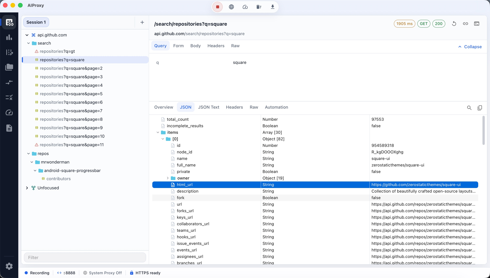
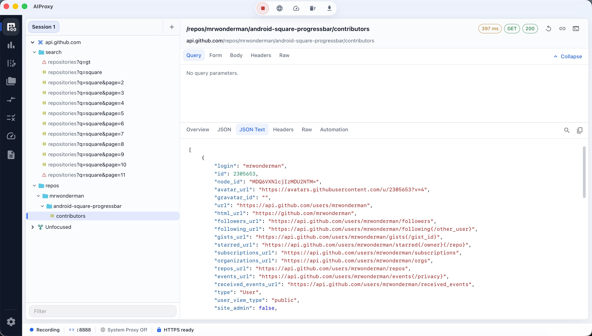
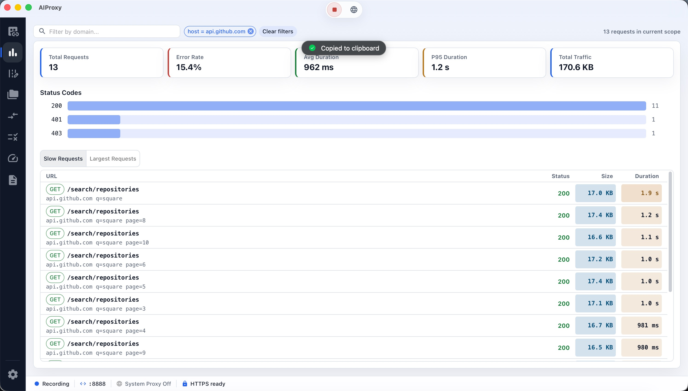

<div align="center">

# AIProxy

**Capture, rewrite, compare — and turn real traffic into evidence your AI agent can use.**

AIProxy is a cross-platform proxy debugging tool for developers. Built with Tauri 2 + Rust, it captures HTTP / HTTPS / WebSocket traffic, replays requests, applies rewrite rules, breakpoints, and throttling locally — then lets Codex, Claude Code, or Cursor investigate real sessions through MCP.

[Download latest release](https://github.com/small-dream/AIProxy/releases/latest) · [Features](#features) · [Build from source](#build-from-source)

[简体中文（默认）](./README.md) | **English**

[](https://github.com/small-dream/AIProxy/actions/workflows/ci.yml)
[](https://github.com/small-dream/AIProxy/releases/latest)
[](./LICENSE)
[](#download)
[](#ai-agent-access)
[](https://tauri.app)
[](https://www.rust-lang.org)

</div>

<p align="center">
  
</p>

<p align="center"><sub>Requests, responses, timing, and WebSocket messages in one desktop workspace.</sub></p>

---

## Why AIProxy

| Common friction | How AIProxy helps |
|-----------------|-------------------|
| Capture, edit, replay, and compare live in different tools | One desktop workspace for the full capture → inspect → modify → replay → compare loop |
| HTTPS, WebSocket, and mobile traffic are tedious to configure | System proxy takeover, MITM decryption, certificate QR setup, and multi-device capture |
| AI needs exported HAR files and copied cURL commands to understand a request | Agents query real sessions over MCP, extract fields, compare results, and cite `sessionId` values |
| Capture data and automation permissions are hard to trust | Data stays local; reads are redacted by default; write controls are off by default; audit logs contain metadata only |

## AI Agent Access

Turn guessing into evidence. Enable the local MCP service in **Settings → Agent Access**, write the client configuration for Codex, Claude Code, or Cursor, and let your agent work directly with real captured traffic.

- **Search and inspect** HTTP / WebSocket sessions by host, path, status, failure kind, or keyword.
- **Go deeper into fields** with request and response headers, bodies, timing, and path-based extraction from large JSON payloads.
- **Compare and summarize** two sessions structurally, with optional AI diff summaries from any OpenAI-compatible model.
- **Diagnose AIProxy** through bounded, redacted app status and log excerpts for certificates, proxy, capture, and connection failures.
- **Take controlled actions** after explicit approval: replay requests, manage temporary rules, or run Rewrite / Map Local automation experiments with runtime evidence.

> Try asking your agent:
>
> “Compare the failed `/api/checkout` request with the last successful run, cite the `sessionId`, and point out the header and timing differences.”

> **Local-first.** The MCP server runs as a local stdio sidecar with no open network port. Control permissions are off by default, reads are redacted by default, and audit logs contain metadata only. Once an agent reads captured content, that content is sent to the corresponding model provider; what gets exposed depends on the permissions and redaction policy you choose.

## Screenshots

| JSON text view | Traffic insights |
|:---:|:---:|
|  |  |
| Raw JSON text, syntax highlighting, and search | Overview cards, host breakdown, status code, and method distributions |

## Features

### Capture & Inspection

- **Full protocol coverage** — HTTP, HTTPS with MITM decryption, and WebSocket.
- **Mobile debugging** — capture iOS, Android, and HarmonyOS traffic over Wi-Fi, with QR-code certificate setup.
- **System proxy takeover** — automatic proxy configuration on Windows, macOS, and Linux, plus manual override.
- **Rich session inspection** — host grouping, filters, request / response headers and bodies, query parameters, timing, transfer stats, and JSON highlighting.
- **HAR import / export** — round-trip with other capture tools, export the current filter, save responses, and copy cURL commands.

### Rules & Fault Injection

- **Rewrite rules** — modify headers, query parameters, status codes, and bodies at the request or response stage.
- **Map Local / Map Remote** — redirect traffic to local files or another server.
- **DNS mapping** — override DNS resolution for domain switching and rollout tests.
- **Script rules** — write interception logic in JavaScript on the QuickJS runtime.
- **Breakpoints** — pause, inspect, modify, mock, or drop requests.
- **Throttling** — apply global presets or target latency, bandwidth, and packet loss by URL, method, and stage.

### Debugging Workflow

- **Compose & Repeat** — edit and resend requests with the full request context preserved.
- **Collections & environments** — save, organize, and batch-run reusable requests.
- **Session Compare** — diff overview, query parameters, headers, bodies, and timing between two sessions.
- **Insights** — aggregate traffic by host, path, and status code to find hotspots quickly.
- **AI diff summaries** — generate a Markdown explanation of Compare results, with payload preview and local redaction before sending.
- **Certificate Center** — generate a root CA, manage trust, and guide mobile certificate installation.

### Experience & Platforms

- **Native desktop feel** — Tauri 2 + Rust core: fast startup and low overhead, not another Electron app.
- **Three platforms** — the same workflow on Windows, macOS, and Linux.
- **Bilingual UI** — English and 简体中文, following the system language by default and switchable in Settings.
- **Light / dark / system themes** — match your working environment.
- **Offline help** — bilingual in-app guides for certificates, capture, rules, Agent Access, and troubleshooting.

## Download

Pre-built installers are available on [GitHub Releases](https://github.com/small-dream/AIProxy/releases/latest).

| Platform | Status | Typical installers |
|----------|--------|--------------------|
| 🪟 Windows | ✅ Supported | `.msi` / `.exe` |
| 🍎 macOS | ✅ Supported | `.dmg` |
| 🐧 Linux | ✅ Supported | `.AppImage` / `.deb` / `.rpm` |

> **Note:** Builds are currently unsigned. On macOS, a browser-downloaded app may be flagged by Gatekeeper as **“damaged and can’t be opened.”** On recent macOS versions, the usual right-click → Open shortcut does **not** bypass this. After dragging `AIProxy.app` to `/Applications`, clear the quarantine attribute:
>
> ```bash
> xattr -cr /Applications/AIProxy.app
> ```
>
> Adjust the path if the app lives elsewhere, for example `~/Downloads/AIProxy.app`. On Windows, SmartScreen may show a warning — click **More info** → **Run anyway**.

## Build from Source

### Prerequisites

- [Node.js](https://nodejs.org/) 22+
- [pnpm](https://pnpm.io/) 10+
- [Rust](https://www.rust-lang.org/tools/install) (stable)

### Setup

```bash
git clone https://github.com/small-dream/AIProxy.git
cd AIProxy
pnpm install

# Install Tauri prerequisites once:
#   macOS:   bash scripts/setup/setup-macos.sh
#   Linux:   bash scripts/setup/setup-linux.sh
#   Windows: powershell -ExecutionPolicy Bypass -File .\scripts\setup\setup-windows.ps1
```

### Run

```bash
# Auto-detect the current platform
pnpm desktop:run

# Or select a platform explicitly
pnpm desktop:run:macos
pnpm desktop:run:windows
pnpm desktop:run:linux
```

### Build & Bundle

```bash
# Build the frontend
pnpm build

# Create distributable bundles (.dmg / .msi / .AppImage, etc.)
pnpm desktop:bundle:macos
pnpm desktop:bundle:windows
pnpm desktop:bundle:linux
```

### Development Logs

Development builds write structured logs to:

- Preferred: `logs/dev/aiproxy-desktop-dev.log`
- Fallback: `%TEMP%/aiproxy-dev/logs/dev/aiproxy-desktop-dev.log`

The previous log is cleared on every launch. When the certificate is trusted, the start button launches the proxy with HTTPS decryption enabled.

## Project Structure

```text
apps/desktop/      Tauri 2 + React 19 desktop application
  src/             Frontend source (pages, features, components, i18n)
  src-tauri/       Rust Tauri shell + proxy integration
crates/            Rust core modules
  proxy-core/      Proxy engine (HTTP / HTTPS / WS capture, MITM)
  rule-engine/     Rewrite / Map / Script rule execution
  tls-manager/     Certificate authority & TLS management
  db/              SQLite persistence layer
  mcp-server/      Local MCP server for AI agents
  agent-control/   Shared local IPC protocol for Agent control
packages/          Shared TypeScript packages
  shared-types/    Frontend ↔ backend contracts
  ui-tokens/       Design tokens
docs/              Architecture, design, release, and user documentation
scripts/           Setup, build, and release scripts
```

## Documentation

- [Documentation index](./docs/README.md)
- [Product requirements (PRD)](./docs/PRD.md)
- [Architecture](./docs/ARCHITECTURE.md)
- [API specification](./docs/API_SPEC.md)
- [MCP & Agent Access architecture](./docs/MCP_AGENT_SKILL_ARCHITECTURE.md)
- [UI guidelines](./docs/UI_GUIDELINES.md)
- [Engineering guidelines](./docs/ENGINEERING_GUIDELINES.md)
- [Build, run & package guide](./docs/BUILD_RUN_PACKAGE_GUIDE.md)
- [Release guide](./docs/RELEASE_GUIDE.md)
- [Architecture Decision Records (ADRs)](./docs/DECISIONS/)

### In-App Guides

The in-app Docs page (**Help → AIProxy Documentation**) provides bilingual guides for certificate setup and capture, WebSocket inspection, rewrite / script / breakpoint rules, Map Local and Map Remote, DNS mapping, throttling, collections and environments, Compose, Insights, Session Compare, settings, and Agent Access. Source: [`apps/desktop/user-guides`](./apps/desktop/user-guides/).

## Contributing

Contributions are welcome! 🎉

- Read the [Contributing Guide](./CONTRIBUTING.md) for the development workflow and commit conventions.
- By participating, you agree to uphold the [Code of Conduct](./CODE_OF_CONDUCT.md).
- New contributors can start with [`good first issue`](https://github.com/small-dream/AIProxy/labels/good%20first%20issue).
- Report security vulnerabilities privately through the [Security Policy](./SECURITY.md). **Do not open a public issue.**
- See the [6-month roadmap](./docs/NEXT_6_MONTH_ROADMAP.md) for planned work.

<details>
<summary><strong>Quality checks for contributors</strong></summary>

```bash
pnpm lint         # ESLint across the workspace
pnpm typecheck    # TypeScript type checking
pnpm test         # Frontend tests (Vitest)
cargo fmt --all   # Format Rust code
cargo clippy --workspace -- -D warnings   # Lint Rust code
cargo test --workspace                     # Rust tests
```

</details>

## Tech Stack

| Layer | Technology |
|-------|-----------|
| Shell | Tauri 2 |
| Frontend | React 19, TypeScript, Vite 8 |
| UI | MUI 9 (Material UI), Emotion |
| State | Zustand, TanStack Query |
| Routing | React Router 7 |
| Core | Rust 2021 |
| i18n | Custom type-safe frontend, rust-i18n for Rust |

## License

[MIT](./LICENSE) © 2024-2026 small-dream

## Acknowledgments

Built with these outstanding open-source projects: [Tauri](https://tauri.app), [React](https://react.dev), [Rust](https://www.rust-lang.org), [MUI](https://mui.com), and many more.
