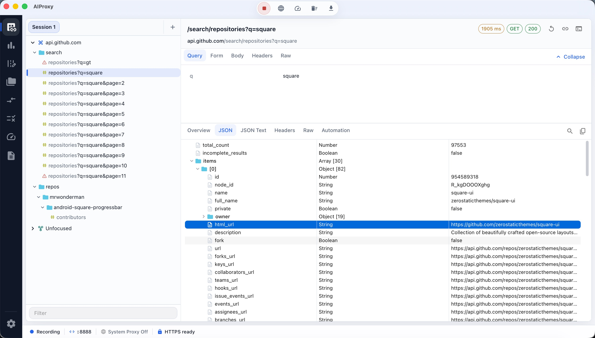
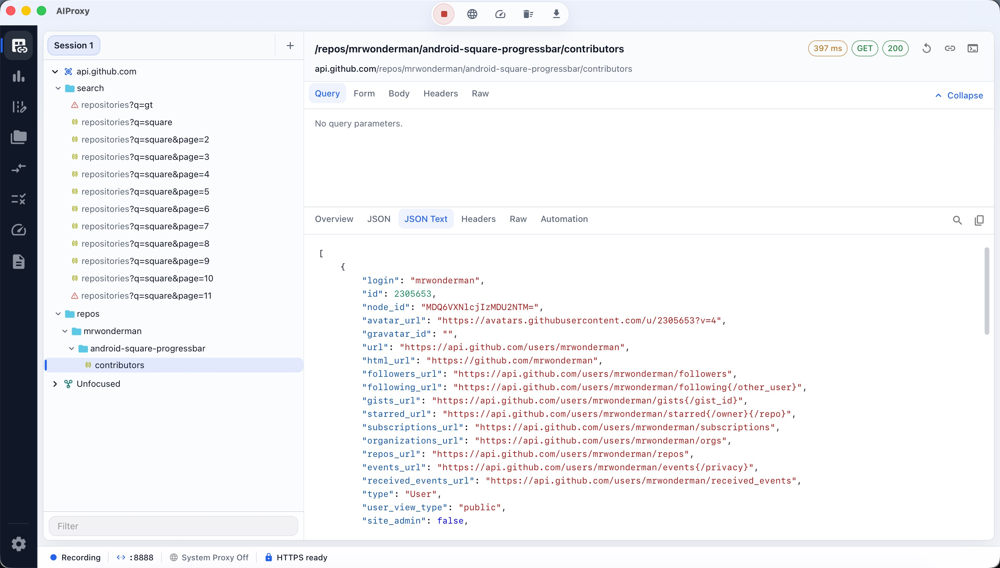
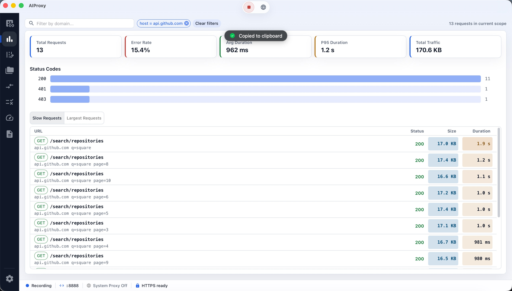

<div align="center">

# AIProxy

**抓包、改写、对比，把真实流量变成 AI Agent 能用的证据。**

AIProxy 是面向开发者的跨平台代理调试工具。基于 Tauri 2 + Rust 构建，在本地完成 HTTP / HTTPS / WebSocket 抓包、请求重放、规则改写、断点与弱网模拟，并通过 MCP 让 Codex、Claude Code、Cursor 直接分析真实会话。

[下载最新版本](https://github.com/small-dream/AIProxy/releases/latest) · [功能特性](#功能特性) · [从源码运行](#从源码运行)

**简体中文（默认）** | [English](./README.en.md)

[](https://github.com/small-dream/AIProxy/actions/workflows/ci.yml)
[](https://github.com/small-dream/AIProxy/releases/latest)
[](./LICENSE)
[](#下载安装)
[](#ai-agent-接入)
[](https://tauri.app)
[](https://www.rust-lang.org)

</div>

<p align="center">
  
</p>

<p align="center"><sub>真实请求、响应、时序与 WebSocket 消息，集中在一个桌面工作台里。</sub></p>

---

## 为什么选择 AIProxy

| 常见痛点 | AIProxy 的做法 |
|----------|----------------|
| 抓包、改包、重放、对比散落在多个工具 | 一个桌面工作台串起抓取、检查、改写、重放与对比 |
| HTTPS、WebSocket 与手机流量配置繁琐 | 系统代理接管、MITM 解密、证书二维码与多端抓包 |
| 让 AI 分析请求前要反复导出 HAR、复制 cURL | Agent 通过 MCP 直接检索真实会话、提取字段、对比并引用 `sessionId` |
| 担心抓包数据和自动化权限失控 | 数据留在本地；读取默认脱敏；写控制默认关闭；审计仅记录元数据 |

## AI Agent 接入

把 AI 从「猜接口」变成「看证据」。在 **设置 → Agent 接入** 中启用本地 MCP 服务，一键写入 Codex、Claude Code 或 Cursor 的客户端配置，之后就可以围绕真实抓包工作。

- **检索与检查**：按主机、路径、状态码、失败类型或关键词定位 HTTP / WebSocket 会话。
- **深入字段**：读取请求头、请求体、响应头、响应体与时序；大型 JSON 可按路径提取，减少无效上下文。
- **对比与总结**：结构化对比两个会话，并可用 OpenAI 兼容模型生成差异总结。
- **诊断 AIProxy**：查看受限、脱敏的应用状态与日志摘要，排查证书、代理、抓包与连接问题。
- **受控操作**：在明确授权后重放请求、管理临时规则，或执行带运行时证据的 Rewrite / Map Local 自动化实验。

> 试试这样问 Agent：
>
> “对比失败的 `/api/checkout` 请求和最近一次成功请求，引用 `sessionId`，并指出响应头与时序上的差异。”

> **本地优先。** MCP 以本地 stdio sidecar 运行，不开放网络端口；控制权限默认关闭，读取默认脱敏，审计日志只记录元数据。Agent 读取后的内容会发送到对应模型服务商，敏感数据是否暴露由你选择的权限与脱敏策略决定。

## 界面预览

| JSON 文本视图 | 流量洞察 |
|:---:|:---:|
|  |  |
| 原始 JSON 文本、语法高亮与搜索 | 概览卡片、主机分布、状态码与请求方法统计 |

## 功能特性

### 抓包与检查

- **全协议抓包** — HTTP、HTTPS（MITM 解密）与 WebSocket。
- **移动端抓包** — 通过 Wi-Fi 抓取 iOS、Android、HarmonyOS 设备流量，证书安装支持二维码。
- **系统代理接管** — 在 Windows、macOS、Linux 上自动配置系统代理，也可手动指定。
- **完整会话检查** — 主机分组、筛选、请求头 / 响应头、请求体 / 响应体、查询参数、时序、传输统计和 JSON 高亮。
- **HAR 导入 / 导出** — 与其它抓包工具往返，支持导出当前筛选结果、保存响应和复制 cURL。

### 规则与故障注入

- **改写规则（Rewrite）** — 在请求或响应阶段修改请求头 / 响应头、查询参数、状态码与请求体 / 响应体。
- **本地映射 / 远程映射** — 将请求指向本地文件或另一台服务器。
- **DNS 映射** — 覆盖 DNS 解析，验证域名切换与灰度场景。
- **脚本规则（Script）** — 使用 JavaScript（QuickJS 运行时）编写拦截逻辑。
- **断点（Breakpoint）** — 暂停、检查、修改、模拟或丢弃请求。
- **弱网模拟（Throttling）** — 用全局预设或按 URL、方法、阶段定向注入延迟、带宽限制与丢包。

### 调试效率

- **请求构造与重发（Compose）** — 编辑请求后立即重放，保留完整请求上下文。
- **集合与环境变量** — 保存、组织并批量执行常用请求。
- **会话对比（Compare）** — 对比两个会话的概览、查询参数、请求头 / 响应头、请求体 / 响应体与时序差异。
- **流量洞察（Insights）** — 按主机、路径与状态码聚合流量，快速发现异常热点。
- **AI 差异总结** — 为 Compare 结果生成 Markdown 解释，发送前可预览载荷并本地脱敏。
- **证书中心** — 生成根 CA、管理信任状态，并引导手机端安装证书。

### 体验与平台

- **原生桌面体验** — Tauri 2 + Rust 核心，启动快、资源占用低，不是又一个 Electron 应用。
- **三平台支持** — Windows、macOS、Linux 使用同一套工作流。
- **双语界面** — English 与简体中文，默认跟随系统语言，也可在设置中切换。
- **浅色 / 暗黑 / 跟随系统** — 适配不同工作环境。
- **离线帮助** — 应用内提供中英双语用户指南，覆盖证书、抓包、规则、Agent 接入与排障。

## 下载安装

预编译安装包发布在 [GitHub Releases](https://github.com/small-dream/AIProxy/releases/latest)。

| 平台 | 状态 | 常见安装包 |
|------|------|------------|
| 🪟 Windows | ✅ 已支持 | `.msi` / `.exe` |
| 🍎 macOS | ✅ 已支持 | `.dmg` |
| 🐧 Linux | ✅ 已支持 | `.AppImage` / `.deb` / `.rpm` |

> **注意：** 当前构建未签名。macOS 用浏览器下载后，Gatekeeper 可能提示 **“已损坏，无法打开，应移至废纸篓”**；在新版 macOS 上「右键 → 打开」**无法**绕过此提示。请先将 `AIProxy.app` 拖到「应用程序」，再清除隔离属性：
>
> ```bash
> xattr -cr /Applications/AIProxy.app
> ```
>
> 路径按 app 实际位置调整，例如 `~/Downloads/AIProxy.app`。Windows 的 SmartScreen 可能提示警告，点击「更多信息」→「仍要运行」即可。

## 从源码运行

### 环境要求

- [Node.js](https://nodejs.org/) 22+
- [pnpm](https://pnpm.io/) 10+
- [Rust](https://www.rust-lang.org/tools/install)（stable）

### 初始化

```bash
git clone https://github.com/small-dream/AIProxy.git
cd AIProxy
pnpm install

# 首次运行前安装 Tauri 前置依赖：
#   macOS:   bash scripts/setup/setup-macos.sh
#   Linux:   bash scripts/setup/setup-linux.sh
#   Windows: powershell -ExecutionPolicy Bypass -File .\scripts\setup\setup-windows.ps1
```

### 启动

```bash
# 自动识别当前平台
pnpm desktop:run

# 或显式指定
pnpm desktop:run:macos
pnpm desktop:run:windows
pnpm desktop:run:linux
```

### 构建与打包

```bash
# 构建前端
pnpm build

# 生成分发包（.dmg / .msi / .AppImage 等）
pnpm desktop:bundle:macos
pnpm desktop:bundle:windows
pnpm desktop:bundle:linux
```

### 开发期日志

开发构建会写入结构化日志：

- 优先：`logs/dev/aiproxy-desktop-dev.log`
- 回退：`%TEMP%/aiproxy-dev/logs/dev/aiproxy-desktop-dev.log`

每次启动会清空旧日志，只保留本次运行。证书已信任时，启动按钮会以 HTTPS 解密模式启动代理。

## 项目结构

```text
apps/desktop/      Tauri 2 + React 19 桌面应用
  src/             前端源码（页面、功能、组件、i18n）
  src-tauri/       Rust Tauri 外壳 + 代理集成
crates/            Rust 核心模块
  proxy-core/      代理引擎（HTTP / HTTPS / WS 抓包、MITM）
  rule-engine/     改写 / 映射 / 脚本规则执行
  tls-manager/     证书颁发与 TLS 管理
  db/              SQLite 持久化层
  mcp-server/      面向 AI Agent 的本地 MCP Server
  agent-control/   Agent 控制共用的本地 IPC 协议
packages/          共享 TypeScript 包
  shared-types/    前后端共享契约
  ui-tokens/       设计令牌
docs/              架构、设计、发布与用户文档
scripts/           初始化、构建与发布脚本
```

## 文档

- [文档索引](./docs/README.md)
- [产品需求文档 PRD](./docs/PRD.md)
- [系统架构](./docs/ARCHITECTURE.md)
- [API 规范](./docs/API_SPEC.md)
- [MCP 与 Agent 接入架构](./docs/MCP_AGENT_SKILL_ARCHITECTURE.md)
- [UI 规范](./docs/UI_GUIDELINES.md)
- [工程规范](./docs/ENGINEERING_GUIDELINES.md)
- [构建、运行与打包指南](./docs/BUILD_RUN_PACKAGE_GUIDE.md)
- [发布指南](./docs/RELEASE_GUIDE.md)
- [架构决策记录（ADR）](./docs/DECISIONS/)

### 应用内帮助

应用内的「文档」页面（**帮助 → AIProxy 文档**）提供中英双语指南：证书安装与抓包、WebSocket 检查、改写 / 脚本 / 断点、本地与远程映射、DNS 映射、弱网模拟、集合与环境变量、请求构造、流量洞察、会话对比、设置与 Agent 接入。源码入口见 [`apps/desktop/user-guides`](./apps/desktop/user-guides/)。

## 参与贡献

欢迎贡献！🎉

- 阅读[贡献指南](./CONTRIBUTING.md)了解开发流程与提交规范。
- 参与本项目即表示同意遵守[行为准则](./CODE_OF_CONDUCT.md)。
- 新手可以从 [`good first issue`](https://github.com/small-dream/AIProxy/labels/good%20first%20issue) 开始。
- 安全漏洞请按[安全策略](./SECURITY.md)私下披露，**不要创建公开 issue**。
- 功能规划见[六个月路线图](./docs/NEXT_6_MONTH_ROADMAP.md)。

<details>
<summary><strong>贡献者质量校验</strong></summary>

```bash
pnpm lint         # 全仓 ESLint
pnpm typecheck    # TypeScript 类型检查
pnpm test         # 前端测试（Vitest）
cargo fmt --all   # 格式化 Rust 代码
cargo clippy --workspace -- -D warnings   # Rust 代码检查
cargo test --workspace                     # Rust 测试
```

</details>

## 技术栈

| 层级 | 技术 |
|------|------|
| 外壳 | Tauri 2 |
| 前端 | React 19、TypeScript、Vite 8 |
| UI | MUI 9（Material UI）、Emotion |
| 状态 | Zustand、TanStack Query |
| 路由 | React Router 7 |
| 核心 | Rust 2021 |
| i18n | 自定义类型安全方案（前端）、rust-i18n（Rust） |

## 许可证

[MIT](./LICENSE) © 2024-2026 small-dream

## 致谢

基于以下优秀的开源项目构建：[Tauri](https://tauri.app)、[React](https://react.dev)、[Rust](https://www.rust-lang.org)、[MUI](https://mui.com) 等。
