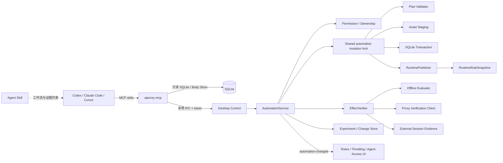

# AIProxy Agent 自动化控制与实验验证方案

## 1. 文档信息

- 文档类型：产品与技术实施记录
- 文档状态：`首版已落地（Rewrite + Map Local）/ 后续资源持续扩展`
- 更新日期：`2026-11-04`
- 适用范围：`apps/desktop`、`crates/agent-control`、`crates/mcp-server`、`crates/proxy-core`、`crates/db`、`packages/shared-types`、Agent Skill
- 关联文档：
  - `docs/PRD.md`
  - `docs/ARCHITECTURE.md`
  - `docs/API_SPEC.md`
  - `docs/UI_GUIDELINES.md`
  - `docs/PAGE_BLUEPRINTS.md`
  - `docs/DECISIONS/ADR-006-local-mcp-agent-access.md`
  - `docs/DECISIONS/ADR-007-agent-control-ipc.md`
  - `docs/DECISIONS/ADR-009-agent-replay-and-temporary-rules.md`
  - `docs/MCP_AGENT_SKILL_ARCHITECTURE.md`

> 本文同时记录已落地实现与后续扩展边界。当前版本已提供 8 个自动化工具、实验与证据记录、资源级回滚和临时资源 TTL；写能力仅覆盖 `Rewrite` 与 `Map Local`。`Map Remote`、`Script`、`DNS`、`Throttle` 与 `Breakpoint` 写入返回 `FEATURE_NOT_AVAILABLE`。现有 `replay_session` 仍直连上游并绕过全部规则，不能作为规则效果证据。

## 2. 结论先行

1. 产品定位从“开放全部规则 CRUD”调整为“**自动化底座 + 可验证实验闭环**”。Agent 不仅要能改规则，还必须能证明规则是否命中、结果是否符合断言，并清楚说明证据强度。
2. 第一批只交付 **Rewrite + Mock（Map Local 托管响应）** 的创建、离线验证、受控代理验证、断言、证据关联和自动清理闭环。其余资源按阶段扩展，不同时放开全部写能力。
3. `replay_session` 继续保留“直连原始上游、绕过规则”的语义，不作为规则效果证据。新增独立的三级验证：离线变换、受控代理请求、真实客户端证据。
4. 不再承诺跨 SQLite、内存 manager 和文件系统“任一步失败都零残留”的单事务原子性。改为共享写协调器、数据库权威状态、统一运行时快照发布和崩溃恢复；只有运行时进入 `active` 后才返回成功。
5. 新能力使用默认关闭的新权限，不扩大原有 `manageRules` 的授权含义。升级不会自动把旧授权迁移成持久化规则、脚本、跨 host 转发或代理验证权限。
6. 回滚按本次 change set 涉及的资源和依赖做资源级冲突检查，不使用整个 workspace 哈希。临时 Throttle 激活采用条件恢复，用户后来切换 Profile 时不得覆盖。
7. 临时计划首版只允许“新建临时资源 + 对 Agent 新建临时 Profile 的受保护激活”，不允许 update/delete 既有资源。临时覆盖用户资源需要未来单独设计覆盖层。
8. Breakpoint 保持全局作用域，不属于 workspace 隔离资源。首版不开放 Breakpoint 写控制；未来只有在具备有次数、时限和作用域限制的断点处理能力后，再用独立权限开放。

## 3. 评审项核实

| 优先级 | 评审结论 | 代码事实 | 本方案处理 |
|---|---|---|---|
| P1 | 缺少可自动完成的效果验证链路 | `replay_session` 使用 `send_direct_request_bytes`；`ADR-009` 明确重放不经过代理、不执行规则 | 保留直连重放；新增离线、代理、真实客户端三级验证并分别报告证据和限制 |
| P1 | “原子应用”超过现有机制能力 | Agent 控制写锁只覆盖 `apps/desktop/src-tauri/src/agent_control.rs` 的控制 IPC；UI 写命令未共享同一锁，且各自是“先 DB、后 manager” | 已引入 UI + Agent 共享的 `automation_mutation_lock`、数据库权威状态、Rewrite + Map 原子快照发布和启动恢复流程 |
| P1 | 升级会扩大已有授权 | 当前 `manageRules` 只代表有限的临时 Rewrite/Map 规则，见 `packages/shared-types/src/agent.ts` 与 `crates/mcp-server/src/config.rs` | `manageRules` 保持旧语义；新增权限默认 `false`，不自动迁移授权 |
| P1 | 回滚易被无关变化阻断，TTL 恢复可能覆盖用户操作 | 现有方案按整个 workspace 的 `stateHash` 判断；Throttle 激活是 workspace 内单一启用 Profile | 改为资源版本 + 依赖指纹；Throttle 使用激活租约和条件恢复 |
| P1 | 临时修改既有资源的恢复语义未定义 | 原计划允许 `ephemeral` 搭配 updates/deletes/activation | 临时计划首版 create-only；只允许受保护激活计划内新建的 Throttle Profile |
| P1 | Breakpoint 工作区隔离未成立 | `BreakpointRule` 没有 `workspaceId`，数据库 `breakpoint_rules` 也无 workspace 列，UI/命令使用全局列表 | 明确全局作用域；首版不开放 Agent 写控制，未来使用独立全局权限 |
| P2 | 幂等、所有权和接口契约不一致 | 原文档写 client 范围幂等，但唯一键只有 workspace + key；`expectedPlanHash` 未进入模型；apply 校验顺序不安全 | 明确安装实例级所有权；幂等先查已提交记录；`expectedPlanHash` 进入 apply 契约；`owner_client` 仅作审计 |

### 3.1 受控代理验证的可行性边界

- 可以新增一个只用于验证的 HTTP client，显式指向 `127.0.0.1:<proxy-port>`，因此不依赖修改系统代理，也不会与 `replay_session` 的直连路径混用。
- HTTPS 验证需要 AIProxy 根证书已生成、SSL interception 已开启，并且验证客户端能加载该根证书完成校验；任一条件不满足时返回 `PROXY_VERIFICATION_UNAVAILABLE`，不能降级冒充“已验证”。
- 代理验证必须单独授权，并受目标 origin 白名单、请求数量、频率、响应体积和幂等方法限制。首版只允许 `GET`、`HEAD`、`OPTIONS`；会改变外部状态的方法交由真实客户端。
- 离线验证需要把 `proxy-core` 当前内部的规则匹配和变换能力暴露为统一评估门面。现有 `apply_request_rewrite_rules`、`apply_response_rewrite_rules`、`apply_map_rules` 均为 crate 内部接口，不能由 MCP 或桌面层直接调用；新增门面必须复用同一匹配器，不能复制第二套规则引擎。

### 3.2 回归修复核实

| 优先级 | 回归问题 | 修复与验收 |
|---|---|---|
| P1 | Rewrite Redirect 可绕过跨 host 授权 | 创建 Rewrite 时解析 `targetUrl`，要求 HTTP/S 且 host 等于精确匹配 host；跨 host 返回 `FEATURE_NOT_AVAILABLE`。代理验证在发送前用同一规则管线预检，并在真实 trace 中再次检查；新增同 host 允许、跨 host 拒绝用例 |
| P1 | 自动化输出泄漏 Header、JSON 与断言敏感值 | 识别 `{name,value}`、`{headerName,value}`、`{paramName,value}`；按 JSON 属性名脱敏；断言结果保留 `subject/path` 并按来源脱敏 `actual`、`expected` 与消息；新增回归用例覆盖 Authorization、`access_token` 和抽取后的断言值 |
| P1 | clear 返回成功但恢复出更早的 Agent 规则 | clear 改为按所有权直接删除目标资源、元数据和完整 change 历史，不再回滚最后一个 change；发布运行时后按实际资源检查残留，残留返回 `CLEANUP_INCOMPLETE` |
| P1 | 常驻计划更新临时资源后运行时仍使用旧快照 | 常驻计划更新属于临时 change 的资源时，validate/apply 返回 `INVALID_ARGUMENT`；运行时合并临时快照前再次确认 metadata 仍归属该 change，防止旧内容覆盖 |
| P2 | 同计划重复更新导致不可回滚 change | validate 拒绝重复 upsert、重复 delete 与同一资源 upsert/delete 重叠；新增三组回归用例，冲突不再延迟到数据库或 rollback |

## 4. 产品目标与交付节奏

### 4.1 核心目标

Agent 应能完成一条可审计的完整任务：

1. 读取基线会话和当前自动化资源。
2. 生成声明式计划并预览影响。
3. 应用计划并确认运行时版本已生效。
4. 通过离线、代理或真实客户端获得证据。
5. 对状态码、Header、JSON 字段和规则 trace 做断言。
6. 解释“未命中、被覆盖、执行失败、断言失败”的区别。
7. 回滚或按 TTL 清理，并验证没有残留资源。

### 4.2 分批交付

| 批次 | 状态 | 交付范围 | Agent 获得的实际价值 |
|---|---|---|---|
| 第一批 | 已落地 | Rewrite + Map Local 的创建、离线验证、代理验证、断言、证据关联、清理 | 自动构造正常/空数据/业务错误响应，并证明改写命中和响应字段符合预期 |
| 第二批 | 已落地 | 轻量实验模型、change set 证据链、规则冲突解释 | 区分未命中、被高优先级规则覆盖、规则执行失败、断言失败 |
| 第三批 | 后续 | 多步骤场景、变量提取、批量验证 | 验证登录链路、分页、超时和错误分支 |
| 第四批 | 后续 | 将验证成功的实验转为常驻规则或可重复场景 | 把一次调试沉淀为以后可重复运行的资产 |
| 后续扩展 | 后续 | Map Remote、DNS、Script、Throttle、Breakpoint | 扩大可处理的问题范围；每项继续使用独立权限和验收标准 |

### 4.3 首版明确非目标

- 不新增应用内 AI 聊天框。
- 不开放 Agent 修改自身 Agent Access 权限、客户端 MCP 配置或 Skill。
- 不开放任意 SQL、任意文件读取、任意 shell 或任意绝对路径 Map Local。
- 不开放 Breakpoint 的远程 resolve/drop/forward，也不在首版创建断点规则。
- 不支持 WebSocket 脚本化、多文件脚本工程、npm 依赖或网络/文件系统脚本 API。
- 不支持 Snapshot 导出、移动设备 ADB/HDC 控制或应用更新控制。
- 不改变 `RulesExportFile` 的现有版本；自动化计划不是导入导出文件的替代物。

## 5. 总体架构



### 5.1 模块职责

- `aiproxy-mcp`：稳定工具契约、参数上限、权限预检、错误映射、证据输出脱敏和审计。
- `agent-control`：控制协议与共享 DTO，不直接访问规则业务实现。
- `AutomationService`：自动化资源的唯一写入口，负责 validate、apply、verify、rollback、clear、TTL 和实验记录。
- 共享写协调器：由 `AppState::automation_mutation_lock()` 暴露的异步互斥锁。Agent 控制、Rules 页保存 / 删除、自动化 TTL 清理和 legacy 临时 Agent 规则发布都通过这把锁串行化；`AgentRuleRegistry` 内部再用 `mutation_lock` 保护注册表快照。
- `RuntimePublisher`：从数据库权威状态、内存临时资源和 legacy 临时 Agent 规则构建 Rewrite + Map 规则对，通过一次 `RuntimeRuleSnapshot` 指针替换发布。请求进入规则阶段时固定使用同一 snapshot，避免看到新 Rewrite 与旧 Map 的混合状态。
- `EffectVerifier`：执行离线、代理或外部证据验证；报告证据等级和限制，不把较弱证据包装成端到端结论。
- `ExperimentRepository`：关联 change set、基线 session、验证请求、断言、证据 session 和清理状态。
- SQLite：保存用户规则、Agent 常驻资源、change set、实验和验证结果；临时资源在应用重启后失效。

### 5.2 运行时快照

首版为避免 Rewrite 与 Map manager 分别热更新造成短暂不一致，引入不可变 `RuntimeRuleSnapshot`：

```rust
pub(crate) struct RuntimeRuleSnapshot {
    pub generation: u64,
    pub rewrite: Arc<Vec<CompiledRewriteRule>>,
    pub map: Arc<Vec<CompiledMapRule>>,
}
```

约束：

- `paired_rule_managers()` 让 RewriteManager 与 MapManager 共享同一运行时；代理请求进入规则处理阶段时只获取一次 snapshot。
- 自动化发布使用数据库中的持久化规则、当前有效临时资源和 legacy `AgentRuleRegistry` 规则合并后的完整列表，分配新的 `runtimeGeneration` 后一次替换。
- 当前统一发布只覆盖 Rewrite + Map。其他 manager 尚未纳入同一发布单元，因此首版不开放跨这些管理器的自动化计划。
- 现有匹配与变换函数继续复用；离线验证通过 `proxy-core` 的共享评估门面执行，不维护第二套规则引擎。

## 6. 公共接口

### 6.1 资源类型与作用域

```ts
type AutomationKind =
  | "rewrite"
  | "map"
  | "dns"
  | "script"
  | "throttleProfile"
  | "throttleRule"
  | "breakpoint"; // 后续阶段，默认不可写

type AutomationScope = "workspace" | "global";
type AutomationLifecycle = "persistent" | "ephemeral";
type AutomationOwner = "agent" | "user";
```

- 除 Breakpoint 外，现有资源均按 workspace 管理。
- Breakpoint 明确为 `global`；在支持全局计划前，`breakpoint` 只出现在读取和未来类型定义中，validate 返回 `FEATURE_NOT_AVAILABLE`。
- 一个计划只能包含一个 scope，不能混合 workspace 和 global 资源。

### 6.2 计划模型

```ts
type AutomationPlan = {
  scope: AutomationScope;
  /** scope=workspace 时必填。 */
  workspaceId?: string;
  lifecycle: AutomationLifecycle;
  /** ephemeral 必填，范围 60-3600 秒；默认 600。 */
  ttlSeconds?: number;
  /** apply 必填。安装实例内同一 scope 下唯一。 */
  idempotencyKey: string;
  upserts: {
    rewrite?: AutomationUpsert<RewriteRule>[];
    map?: AutomationMapUpsert[];
    dns?: AutomationUpsert<DnsMappingRule>[];
    script?: AutomationScriptUpsert[];
    throttleProfile?: AutomationUpsert<ThrottleProfile>[];
    throttleRule?: AutomationThrottleRuleUpsert[];
    breakpoint?: AutomationUpsert<BreakpointRule>[];
  };
  deletes?: Array<{ kind: AutomationKind; id: string; expectedVersion: string }>;
  activation?: {
    throttleProfileId?: string | null;
    throttleProfileRef?: string;
    /** 条件激活；当前与此值不一致时拒绝。null 表示当前无启用 Profile。 */
    expectedActiveProfileId?: string | null;
  };
  assets?: AutomationAsset[];
};

type ApplyAutomationPlanRequest = {
  plan: AutomationPlan;
  /** validate 返回；用于确认计划内容没有被替换。 */
  expectedPlanHash: string;
  /** validate 返回；覆盖本次涉及资源及其冲突/引用依赖，不是整个 workspace。 */
  expectedScopeHash: string;
};

type AutomationUpsert<T> = {
  /** 新建时省略；更新时必填，并必须提供 expectedVersion。 */
  id?: string;
  expectedVersion?: string;
  /** 仅用于计划内引用，必须唯一。 */
  ref?: string;
  resource: Omit<T, "id">;
};
```

补充约束：

- `idempotencyKey` 为 16-128 字节；调用方重试必须复用完全相同的 key、`expectedPlanHash` 和计划内容。
- 新建资源省略 `enabled` 时按 `false` 处理；更新省略时保持原值，避免后台改写用户配置。
- 同一种资源的新建、更新和删除合计最多 100 项；序列化后最大 3 MiB。
- `ref` 只用于计划内引用，不写入数据库；apply 返回 `resourceIdsByRef`。
- `deletes` 与 `upserts` 指向同一资源时校验失败。
- 同一 `(kind, id)` 在一个计划中只能出现一次更新或删除；重复 upsert、重复 delete、upsert/delete 重叠都在 validate 阶段返回 `INVALID_ARGUMENT`。
- 首版任何 `activation` 字段都会返回 `FEATURE_NOT_AVAILABLE`；Throttle 激活与条件恢复留到后续版本。
- `expectedScopeHash` 的计算闭包包含目标资源，以及可能与同一请求竞争的同 host / 同阶段 Rewrite 与 Map 候选；不要求整个 workspace 的无关资源保持不变。
- ephemeral 计划只能新建资源，不能更新或删除既有资源；不能创建 Script、DNS、Throttle 或 Breakpoint，也不能使用 `global` scope。
- persistent 计划不能更新仍归属 ephemeral change 的资源；此时返回 `INVALID_ARGUMENT`。等待 TTL、先 clear 或新建常驻资源，禁止跨生命周期原地转换。

### 6.3 MCP 工具

| 工具 | 权限 | 类型 | 说明 |
|---|---|---|---|
| `list_automation_resources` | `manageAutomation` | 只读 | 分页返回资源摘要、scope、所有权、版本、TTL、当前激活 Profile、最近实验状态 |
| `get_automation_resource` | `manageAutomation` | 只读 | 按 `kind + id` 返回完整资源和资源版本；Script 源码受 `manageScripts` 约束 |
| `validate_automation_plan` | `manageAutomation`，按目标追加权限 | 只读 | 校验计划、编译脚本文本、检查引用/所有权/冲突，返回 `planHash`、`scopeHash`、风险和变更摘要 |
| `apply_automation_plan` | `manageAutomation`，按目标追加权限 | 写 | 应用计划；仅当 DB 提交、运行时发布完成并进入 `active` 后返回成功 |
| `verify_automation_change` | `manageAutomation`；代理模式追加 `manageProxiedVerification` | 读/受控写 | 对 change set 执行离线、代理或外部证据验证，并返回断言、证据和限制 |
| `get_automation_change` | `manageAutomation` | 只读 | 返回 change set、实验、验证记录、清理状态和运行时 generation |
| `rollback_automation_change` | `manageAutomation`；涉及用户资源追加 `manageUserAutomation` | 写 | 资源级回滚常驻 change set；被覆盖或依赖变化时拒绝 |
| `clear_agent_automation` | `manageAutomation` | 写 | 只清理当前安装实例中 Agent 拥有的资源；不得删除用户资源 |

现有 `create_agent_rule`、`list_agent_rules`、`remove_agent_rules`：

- 继续使用 `manageRules`，不扩展为持久化或脚本能力。
- 至少保留一个版本周期；内部可委托给 `AutomationService` 的临时资源子集，但不能让旧工具突破旧权限边界。
- 工具描述标记 deprecated，并引导新工作流。

### 6.4 验证模型

```ts
type VerificationMode = "offline" | "proxy" | "external";

type VerifyAutomationRequest = {
  changeId: string;
  mode: VerificationMode;
  /** offline/proxy 模式的基线来源。 */
  baselineSessionIds?: string[];
  /** offline/proxy 模式的验证请求定义。 */
  requests?: Array<{
    ref: string;
    baselineSessionId?: string;
    method?: string;
    url?: string;
    headers?: HeaderEntry[];
    body?: string;
    jsonSet?: Record<string, JsonValue>;
  }>;
  /** external 模式使用真实客户端刚产生的会话。 */
  externalSessionIds?: string[];
  assertions: AutomationAssertion[];
};

type AutomationAssertion = {
  id: string;
  subject:
    | "status"
    | "requestHeader"
    | "responseHeader"
    | "responseBody"
    | "queryParam"
    | "ruleTrace"
    | "durationMs";
  path?: string;
  operator: "equals" | "contains" | "exists" | "notExists" | "gte" | "lte";
  expected?: JsonValue;
};
```

验证结果必须区分以下状态，不能统一输出“成功”或“失败”：

- `passed`：所有断言通过，证据等级满足请求。
- `not_matched`：请求存在，但没有规则命中。
- `shadowed`：目标规则存在，但被更高优先级或更早生效的规则覆盖。
- `rule_failed`：规则命中，但变换、脚本、映射或资源读取执行失败。
- `upstream_failed`：请求到达上游但上游失败，不能归因于规则。
- `assertion_failed`：规则执行完成，但响应或 trace 断言不成立。
- `insufficient_evidence`：只有离线或间接证据，不能支持端到端结论。
- `expired`：临时资源或 change set 已失效，无法继续验证。

每条断言结果返回 `subject` 与 `path`，说明 `actual` 的来源。输出按 Header / Query / JSON / trace 的结构和断言来源脱敏；抽取成裸字符串前先确定敏感字段名，不能让字段上下文丢失。

### 6.5 三级验证与证据声明

| 验证级别 | 执行方式 | 能证明什么 | 不能证明什么 |
|---|---|---|---|
| 离线变换 `offline` | 基于基线 session 调用统一规则评估门面，不联网 | 规则匹配、Rewrite 后的 Header/Body/JSON、Mock 资产内容符合预期 | 规则是否已注册到真实代理、真实网络链路是否生效 |
| 受控代理 `proxy` | 验证客户端显式连接本地 AIProxy 端口，请求经过实际规则管线 | 规则在实时代理中命中、trace 正确、最终响应符合断言 | 真实 App/页面是否正确渲染；HTTPS 依赖根证书与拦截配置 |
| 真实客户端 `external` | 用户或测试工具触发，Agent 通过 `wait_for_sessions` 获取新 session，再用 external 模式做断言 | 真实客户端行为、真实 TLS/网络链路和用户可见结果 | 无法保证每次都完全自动化；可能需要用户或外部测试工具配合 |

证据输出必须包含：

- `changeId`、`experimentId`、`mode`、`evidenceLevel`、`runtimeGeneration`。
- `baselineSessionIds`、`evidenceSessionIds`、`ruleTraceRefs`。
- 每条断言的 `passed/failed` 与可解释消息。
- `limitations`，特别是“离线证据不代表代理已生效”“代理证据不代表真实客户端已渲染”。
- 不得使用 `replay_session` 生成的 session 作为 Rewrite/Map/Script/Throttle 生效证据；external 模式会直接拒绝 `timingSource=agentReplay` 的会话。

### 6.6 规则冲突解释

验证器在 `not_matched`、`shadowed` 或 `rule_failed` 时必须附带诊断：

- 候选规则及优先级、匹配方式、scope、workspace 和 host lock。
- 最终命中的规则 ID，以及未命中原因：host、method、stage、pattern、enabled 或 workspace 不匹配。
- Map 的最终 upstream URL；Rewrite 的 trace outcome；Throttle 的延迟/丢包 trace；Script 的编译或执行错误。
- 被覆盖时指出覆盖规则 ID，不要求 Agent 自行猜测。

## 7. 权限模型与安全边界

### 7.1 权限字段

| 权限 | 默认 | 授权范围 |
|---|---:|---|
| `manageRules` | `false` | 保持旧语义：仅有限、内存、TTL 的临时 Rewrite/Map 规则 |
| `manageAutomation` | `false` | 管理当前安装实例中 Agent 自有的持久化/临时自动化资源，不含用户资源 |
| `manageUserAutomation` | `false` | 修改、删除、启停、回滚用户已有自动化资源 |
| `manageScripts` | `false` | 创建、更新、编译和执行 Agent Script；与 `manageAutomation` 同时生效 |
| `manageCrossHostMappings` | `false` | Map Remote 切换到非原 host 的目标 origin |
| `manageProxiedVerification` | `false` | 通过本地 AIProxy 代理发送验证请求 |
| `manageGlobalAutomation` | `false` | 后续阶段管理 Breakpoint 等全局资源；首版不提供写入口 |

规则：

- `manageAutomation` 不自动包含 `manageUserAutomation`、`manageScripts`、`manageCrossHostMappings` 或 `manageProxiedVerification`。
- 只读列表默认返回资源摘要，不返回 Script 源码、凭据 Header 或完整敏感 Body。
- `manageUserAutomation` 只授予资源修改权，不授予修改 Agent Access 权限的能力。
- 修改用户 Script 需要同时具备 `manageUserAutomation` 与 `manageScripts`。

### 7.2 权限版本与升级迁移

- `Agent Access` 配置版本提升到 `4`；新增权限字段全部使用 `#[serde(default)] = false`。
- `manageRules` 在升级后继续只控制旧临时规则工具，不推导任何新权限为 `true`。
- 旧版本配置、旧 sidecar 或缺失字段统一归一化为“新权限关闭”，不会因为用户曾开启 `manageRules` 而扩大授权。
- 设置页显示“本版本新增高级自动化权限，默认未启用”，由用户逐项授权；授权一次后在配置版本不变期间持续生效，不要求每次任务重复确认。
- 若未来需要批量迁移，只允许生成迁移提示，不允许静默继承授权。

### 7.3 安装实例级所有权

- Agent 资源的所有权边界是“当前 AIProxy 安装实例”，不是 Codex/Claude Code/Cursor 中某一客户端进程。
- 同一安装实例上的 MCP 客户端共享 Agent 自有资源管理权；`owner_client`、`client_version` 只作为审计来源，不作为访问控制依据。
- 用户已有规则默认没有 `automation_resources` ownership 行，读取时按 `user` 处理；不能因为缺少行而误判为 Agent 资源。
- `clear_agent_automation` 只清理 Agent 自有资源；清理范围必须显式指定 `persistent`、`ephemeral` 或 `all`。
- 用户可将常驻 Agent 资源“转为我的规则”；转换后具备用户资源所有权，Agent 再修改必须依赖 `manageUserAutomation`。

### 7.4 跨 host Map Remote

- 常驻计划允许跨 host，但必须同时具备 `manageAutomation` 与 `manageCrossHostMappings`。
- Agent Access 设置维护精确目标 origin 白名单，例如 `https://staging.example.com:443`；不支持通配 host。
- 临时实验永远不允许跨 host。
- 跨 host 时默认剥离 `Authorization`、`Cookie`、`Proxy-Authorization` 和识别为敏感的自定义 Header；UI 必须展示源 host、目标 origin 与凭据处理方式。
- Query 中可能携带 token；validate 必须给出高风险警告，UI 展示目标 URL 的脱敏摘要，不能静默转发。

### 7.5 代理验证安全

- 只允许连接当前 AIProxy 监听端口，不能由调用方传入任意 proxy URL。
- 目标 origin 必须来自单独的验证白名单；默认可由用户对当前 workspace 已存在的 host 授权。
- 首版只允许幂等方法，单次最多 20 个请求，单并发，10 次/分钟。
- 响应体读取沿用 Agent Access 的体积和脱敏限制；原始 Body 需要现有 `readRawBodies` 权限。
- HTTPS 验证必须具备可用根证书、已开启 SSL interception，且代理正在运行；否则返回结构化不可用原因。
- 发送前用统一离线规则管线预检最终 URL 与 Redirect trace，发现跨 host 变换时拒绝；真实请求后再次检查捕获 trace，异常请求标记为 `rule_failed` 并记录 `limitations`，不能计为通过。

## 8. 资源规则

### 8.1 Rewrite（第一批）

- 支持请求/响应 Header、请求 Query、请求/响应 Body、JSON 字段修改和 Redirect。
- 支持 1..n 个有序动作，复用现有 `actions` 数组和 trace。
- 新建默认禁用；显式 `enabled` 后才影响流量。
- 离线验证必须与代理验证使用同一匹配和变换函数，建立一致性测试，禁止复制实现。
- Redirect `targetUrl` 必须为 HTTP/S，且目标 host 等于规则匹配的精确 host；跨 host Redirect 首版返回 `FEATURE_NOT_AVAILABLE`，`manageCrossHostMappings` 不能绕过。

### 8.2 Mock / Map Local（第一批）

- 第一批的 Mock 使用 `managedAsset` 和 Map Local 响应，不依赖需要人工处理的 Breakpoint。
- `managedAsset`：计划携带文件内容，服务端写入应用数据目录并记录归属。
- `approvedPath`：用户先在 Agent Access 中批准根目录，Agent 只能引用其下路径。
- 使用 canonicalize 解析路径，拒绝 `..`、越界和符号链接逃逸；Windows 路径包含判断必须大小写不敏感。
- 批准根目录最多 10 个，不允许 Agent 通过工具自行添加或修改。
- 支持 JSON 断言，区分“规则未命中”和“Mock 内容不符合预期”。

### 8.3 Map Remote（后续批次）

- 同 host 的路径/Query 映射在具备 `manageAutomation` 后可开放。
- 跨 host 必须满足 7.4 的独立权限、origin 白名单和凭据剥离要求。
- UI 和验证结果必须展示原始 URL、最终映射 URL、Map trace outcome 和是否跨 host。

### 8.4 DNS Mapping（后续批次）

- 使用现有 `DnsManager` 和校验规则。
- `targetIp` 必须解析为合法 IPv4/IPv6。
- 规则按 workspace 隔离，优先级和启停行为与 UI 一致。
- 离线验证只能证明匹配结果，不能证明真实 DNS 解析路径；需要代理或真实客户端证据。

### 8.5 Script（后续批次）

- 只接受内联 `javascript` / `typescript` 源码，拒绝 `sourcePath`。
- 服务端调用现有编译链路，验证导出入口、TypeScript 语法和 128 KiB 上限。
- 沿用现有运行时限制：单次 500 ms、16 MB heap、50 条日志、8 KiB 单条日志、最多 64 并发。
- Agent 不能访问文件系统、网络、模块加载、系统命令或 Tauri/Node/Deno API。
- 首次开放时不自动在历史基线上执行脚本；先编译和静态检查，再由代理验证或外部证据确认效果。

### 8.6 Throttle Profile / Rule（后续批次）

- 计划可同时创建 Profile 与引用它的 Throttle Rule，通过 `ref` 建立引用。
- Profile 与 Rule 都显式控制 `enabled`；`activation` 单独控制当前激活 Profile。
- 定向 Rule 只有在引用 Profile 处于启用状态时生效，沿用现有语义。
- 激活必须记录 `expectedActiveProfileId` 和实验激活租约。到期、清理或回滚时，只有当前仍由该实验激活且租约匹配，才恢复旧 Profile；否则记录 `activation_restore_skipped_user_changed`，不得覆盖用户后来选择的 Profile。
- 临时计划只能激活计划内新建的 Profile，不得暂时修改用户已有 Profile 的 enabled 状态。

### 8.7 Breakpoint（后续阶段，首版不开放）

- `BreakpointRule` 当前没有 `workspaceId`，`breakpoint_rules` 表也没有 workspace 列；断点必须按全局资源处理。
- Agent 创建断点后无法远程 resolve/drop/forward，启用的断点会让请求等待用户在 UI 中处理，容易让自动实验停在等待状态。
- 首版只支持读取和诊断现有断点，不开放写控制。
- 未来若开放，必须新增 `manageGlobalAutomation`、有次数/时限/作用域限制的断点处理能力，并在 UI 明确提示“全局生效，跨 workspace”。

## 9. 数据模型

新增 5 张表，仅做增量迁移，不改写现有用户规则。

### 9.1 `automation_resources`

```sql
CREATE TABLE automation_resources (
    resource_kind        TEXT NOT NULL,
    resource_id          TEXT NOT NULL,
    scope                TEXT NOT NULL,
    scope_key            TEXT NOT NULL,
    workspace_id         TEXT,
    owner_kind           TEXT NOT NULL,
    created_by_client    TEXT,
    created_by_version   TEXT,
    change_id            TEXT,
    expires_at           TEXT,
    created_at           TEXT NOT NULL,
    updated_at           TEXT NOT NULL,
    PRIMARY KEY (resource_kind, resource_id)
);
```

用途：

- 标识资源由 Agent 还是用户拥有。
- 记录 scope、创建 change set、来源客户端审计信息和 TTL。
- 避免给各类规则表逐一增加重复元数据列。

### 9.2 `automation_change_sets`

```sql
CREATE TABLE automation_change_sets (
    id                    TEXT NOT NULL PRIMARY KEY,
    scope                 TEXT NOT NULL,
    scope_key             TEXT NOT NULL,
    workspace_id          TEXT,
    idempotency_key       TEXT NOT NULL,
    plan_hash             TEXT NOT NULL,
    expected_plan_hash    TEXT NOT NULL,
    scope_hash_before     TEXT NOT NULL,
    scope_hash_after      TEXT NOT NULL,
    lifecycle             TEXT NOT NULL,
    status                TEXT NOT NULL,
    runtime_generation    INTEGER,
    client_name           TEXT,
    client_version        TEXT,
    summary_json          TEXT NOT NULL,
    created_at            TEXT NOT NULL,
    committed_at          TEXT,
    activated_at          TEXT,
    reverted_at           TEXT,
    expires_at            TEXT,
    UNIQUE (scope_key, idempotency_key)
);
```

`status` 取值：`prepared`、`committed`、`active`、`publish_failed`、`reverting`、`reverted`、`aborted`、`promoted`。只有 `active` 才向调用方报告应用成功；用户执行“转为我的规则”后为 `promoted`，该 change set 不再允许回滚。

### 9.3 `automation_change_items`

```sql
CREATE TABLE automation_change_items (
    change_id            TEXT NOT NULL,
    sequence             INTEGER NOT NULL,
    resource_kind        TEXT NOT NULL,
    resource_id          TEXT NOT NULL,
    operation            TEXT NOT NULL,
    version_before       TEXT,
    version_after        TEXT,
    before_json          TEXT,
    after_json           TEXT,
    dependencies_json    TEXT,
    PRIMARY KEY (change_id, sequence),
    FOREIGN KEY (change_id) REFERENCES automation_change_sets(id) ON DELETE CASCADE
);
```

`dependencies_json` 保存回滚需要的资源引用、Throttle Profile 版本和激活指纹。回滚只检查这些资源，不要求整个 workspace 未变化。

### 9.4 `automation_experiments`

```sql
CREATE TABLE automation_experiments (
    id                    TEXT NOT NULL PRIMARY KEY,
    change_id             TEXT NOT NULL,
    objective             TEXT NOT NULL,
    baseline_session_ids  TEXT NOT NULL,
    status                TEXT NOT NULL,
    cleanup_state         TEXT NOT NULL,
    created_at            TEXT NOT NULL,
    updated_at            TEXT NOT NULL,
    FOREIGN KEY (change_id) REFERENCES automation_change_sets(id) ON DELETE CASCADE
);
```

实验模型保持轻量，只关联 existing change set、session 和 trace，不建设复杂任务编排引擎。

### 9.5 `automation_verifications`

```sql
CREATE TABLE automation_verifications (
    id                    TEXT NOT NULL PRIMARY KEY,
    experiment_id         TEXT NOT NULL,
    mode                  TEXT NOT NULL,
    request_json          TEXT NOT NULL,
    assertions_json       TEXT NOT NULL,
    result_json           TEXT NOT NULL,
    evidence_session_ids  TEXT NOT NULL,
    limitations_json      TEXT NOT NULL,
    created_at            TEXT NOT NULL,
    FOREIGN KEY (experiment_id) REFERENCES automation_experiments(id) ON DELETE CASCADE
);
```

### 9.6 哈希与版本

- `resourceVersion`：单个资源规范化后的 SHA-256，包含内容和依赖引用。
- `scopeHash`：计划影响闭包内全部资源版本、冲突候选和激活指纹的 SHA-256。
- `planHash`：规范化计划内容的 SHA-256；validate 和 apply 必须逐字节等价。
- `workspaceStateHash`：仅用于展示和诊断，不作为 apply/rollback 的唯一前置条件。
- `runtimeGeneration`：每次成功发布 Rewrite + Map 运行时快照递增，唯一权威来源是共享的 `RewriteManager::runtime_generation()`；验证结果会记录当时的 generation。

## 10. 写入、发布与崩溃恢复

### 10.1 共享写协调器

- 首版使用 `AppState` 上的一把共享 `automation_mutation_lock`，所有 workspace 的自动化写入与 legacy 临时 Agent 规则发布串行执行。当前没有按 scope 并行，优先保证一致性与实现可审计性。
- Agent 控制写入口、Rules 页 Rewrite / Map 保存与删除、过期清理、回滚、提升和 clear 都获取同一把锁。
- `AgentRuleRegistry` 另有内部 `mutation_lock`，保护创建、删除、过期清理和快照读取；发布时在注册表锁内合并 legacy 规则，再与自动化资源一起原子发布。
- 只读查询不持有写锁；代理请求不持有 DB 锁，只读取已发布快照。

### 10.2 validate 流程

1. 检查权限、scope、资源类型和数量限制。
2. 读取目标资源版本、冲突候选和依赖，计算 `scopeHash`。
3. 规范化 ID、ref、默认值、动作顺序和引用。
4. 校验匹配模式、优先级、动作组合、脚本编译和 Map Local 路径。
5. 拒绝同一计划内的重复更新、重复删除与 upsert/delete 重叠，并拒绝常驻计划跨生命周期更新临时资源。
6. 检查所有权、跨 host 权限、凭据剥离策略和用户资源授权；Redirect 目标必须与匹配 host 一致。
7. 计算 `planHash`，返回风险、变更摘要、预计运行时变更和 `canApply`。

validate 不写数据库、不修改 manager、不发布 runtime。

### 10.3 apply 流程

1. **先查幂等记录。** 若 `(scope_key, idempotency_key)` 已存在且 `plan_hash` 相同：`active`/`reverted` 直接返回已存结果，`committed`/`publish_failed` 重新尝试运行时发布后再返回，不再检查当前资源状态；若计划不同，返回 `IDEMPOTENCY_CONFLICT`；已提升或终止的状态返回 `CHANGE_NOT_APPLICABLE`。
2. 获取共享 `automation_mutation_lock`，重新读取状态。
3. 校验 `expectedPlanHash`、`expectedScopeHash`、资源版本、所有权和权限。
4. 准备托管资产到 staging，生成完整的目标 `RuntimeRuleSnapshot`；此阶段不发布运行时。
5. 在单个 SQLite 事务中写入业务数据、ownership、change items 和 change set，状态设为 `committed`，并分配 `runtime_generation`。
6. 对本 generation 执行一次统一运行时发布。发布成功后，将 change set 标记为 `active`；只有此时返回成功。
7. 发送一次 `automation-changed`，返回 `changeId`、`runtimeGeneration`、`resourceIdsByRef` 和可选实验 ID。

失败语义：

- 事务前失败：状态保持原样，staging 资产清理。
- DB 事务失败：不发布 runtime，返回结构化错误。
- DB 已提交但 runtime 发布失败：change set 标记为 `publish_failed`，返回 `RUNTIME_PUBLISH_FAILED` 并包含 `changeId`、`committed=true`、`retryable=true`；不得返回“未应用”。
- runtime 已发布但 `active` 状态写入失败：返回 `ACTIVATION_RECORD_FAILED` 并包含 `changeId`；调用方应先读取 change 状态，不能直接重复创建新计划。
- 写入成功但响应丢失：调用方用相同幂等键重试，服务端返回同一结果；即使其他资源期间变化，也不以状态哈希冲突拒绝已提交的重试。
- 不可达 staging 文件允许短暂存在，但不可见；启动恢复和定期清理任务负责删除。不承诺文件系统与 DB 在所有崩溃点形成单事务。

### 10.4 崩溃恢复

应用启动时执行自动化恢复：

1. 将重启前仍有效的 ephemeral change set 标记为 `aborted`，删除其资源元数据与 staging 资产，实验清理状态记录为 `expired_by_restart`。
2. 对常驻的未完成 change set，比较每个目标资源的当前版本与 `versionBefore` / `versionAfter`，识别“全部在变更前”“全部在变更后”或 `RECOVERY_CONFLICT`。
3. 全部在变更后时重新发布当前数据库状态并标记 `active`；全部在变更前时标记 `reverted`，实验记录 `recovered_rollback`。
4. 混合状态不猜测恢复，返回结构化 `RECOVERY_CONFLICT`，保留状态供 UI 与诊断解释。
5. 清理过期临时资源和 staging 资产；有变更时发送 `automation-changed`。

### 10.5 临时资源生命周期

- 临时计划首版只允许新建资源；不允许 update/delete 既有资源。
- 临时资源进入内存 runtime，并写入 `automation_resources` / change set / 实验审计记录；不写入用户规则表，因此重启后不会重新生效。
- TTL 默认 600 秒，范围 60-3600 秒；后台每 15 秒检查一次。
- 到期清理必须获取共享 `automation_mutation_lock`，发布新的 runtime generation，再发送刷新事件。
- 应用重启即失效；不尝试恢复临时规则本体，只保留实验审计记录。
- Throttle 激活使用条件恢复：只有当前 Profile、激活租约和实验仍匹配时才恢复旧 Profile；否则跳过并记录原因。

## 11. 回滚

- 只有常驻 change set 支持 rollback；临时实验通过 TTL 或 `clear` 清理。
- 回滚不要求整个 workspace 哈希一致，只检查 change items 中的资源版本和 `dependencies_json`。
- 反向操作：删除新建项、恢复更新前快照、重建删除项、条件恢复 Throttle 激活状态。
- 如果无关的临时规则到期，不得阻断回滚；如果目标资源或依赖变化，返回 `ROLLBACK_CONFLICT`。回滚前还会验证 change 仍为 `active`、请求携带的 `expectedScopeHash` 与当前 `rollbackScopeHash` 一致。
- 回滚同样走 DB 事务、统一运行时发布和崩溃恢复，不允许“DB 已回滚但 runtime 仍使用旧 generation”。
- 保留最近 20 个 change set 或 7 天；过期记录不可回滚，但审计日志继续保留元数据。
- `clear_agent_automation` 不替代 rollback：它按所有权直接删除 Agent 自有资源及元数据，并终止这些资源的完整 change 历史，不恢复更早的 Agent 版本、用户资源或历史激活状态。发布后仍有目标残留时返回 `CLEANUP_INCOMPLETE`。

## 12. UI 与事件

### 12.1 Rules / Throttling 页面

- 资源行统一显示 `Agent` 标记、scope、`常驻/临时`、到期时间和最近实验状态。
- 常驻 Agent 资源提供“转为我的规则”；临时资源只读，可删除或按实验清理。
- Map Remote 展示来源 host、目标 origin、是否跨 host、凭据是否被剥离；跨 host 使用 warning 样式。
- Throttle 页面展示当前激活 Profile 是否由实验设置、实验结束时间以及“用户已切换 Profile，实验不会覆盖”的状态。
- Breakpoint 继续显示为全局规则，不添加 workspace 标记；在其写能力开放前不提供 Agent 创建入口。

### 12.2 实验与证据视图

- change set 详情展示目标、基线 session、应用结果、运行时 generation、清理状态、资源前后版本与依赖摘要。
- 验证记录按 `offline`、`proxy`、`external` 分组，并醒目标注证据等级和限制。
- 断言失败时展示具体 subject/path/expected/actual 摘要，敏感值继续脱敏。
- 冲突时展示被哪条规则覆盖、优先级差异和最终命中规则。
- 提供最近 change set 列表、回滚和实验清理，不新建独立任务编排页面。

### 12.3 Agent Access 设置

- 新增 `manageAutomation`、`manageUserAutomation`、`manageScripts`、`manageCrossHostMappings`、`manageProxiedVerification` 开关，全部默认关闭。
- 明确说明 `manageRules` 仍只控制旧临时规则，不复用其文案暗示持久化能力。
- Map Local 批准根目录最多 10 个，仅通过系统文件夹选择器添加；路径失效时显示 warning，不静默删除。
- 跨 host 目标 origin 白名单和代理验证 origin 白名单分开维护，显示规范化后的 origin。
- 配置升级后显示“新权限未启用”提示，由用户主动勾选。

### 12.4 查询刷新

新增 `automation-changed` 控制事件，载荷包含：

- `reason`、`changeId`、`changeIds`、`runtimeGeneration`、`scope`、`workspaceId`、`lifecycle`、`status`。
- `affectedResources[]`（kind/id/operation）。
- `experimentId`（可选）、清理状态与 `timestamp`。

前端按受影响资源定向刷新 Rewrite / Map、实验详情和 Agent 控制状态，不清空用户正在编辑的草稿；`clear_agent_automation` 没有实际资源可清理时不发送空事件。现有 `agent-control-action` 继续用于操作通知和审计，不替代资源刷新事件。

## 13. 版本与兼容

- 控制协议保持 v1，仅新增 operation；未知 operation 继续映射为 `CONTROL_UNAVAILABLE`。
- MCP 工具 schema 从 `3.2` 升级到 `3.3`；`meta.schemaVersion` 同步。
- 内置 Agent Skill 从 `3.3` 升级到 `3.4`，加入计划、验证、证据和清理工作流。
- Agent Access 配置版本从 `3` 升级到 `4`；新权限字段缺失即为 `false`。
- `RulesExportFile` 保持 `version: 1`；自动化计划不直接复用导出文件作为写入输入。
- 旧 sidecar 遇到新工具调用返回升级提示；新 sidecar 遇到旧桌面端返回 `CONTROL_UNAVAILABLE`。
- 数据库迁移仅新增表和索引，不新增规则表列，不回填现有用户资源。

## 14. 实施阶段

### 阶段 A：契约、权限与数据层 — 已完成

- 新增 `packages/shared-types/src/automation.ts`，定义计划、验证、断言、change/experiment DTO。
- 扩展 `AgentAccessPermissions` 与配置版本，补权限迁移和旧配置测试。
- 新增 5 张表、迁移测试、资源版本、scope hash 和幂等查询。
- 让所有 UI 与 Agent 写入口接入共享 `automation_mutation_lock`。

### 阶段 B：统一运行时与第一批写能力 — 已完成

- 在 `proxy-core` 引入共享 `RuntimeRuleSnapshot` / 原子发布方法，先覆盖 Rewrite 和 Map。
- 提取可复用的规则匹配与变换门面，供 proxy 和 offline verifier 共用。
- 实现 Rewrite + Map Local 的 validate、apply、rollback、TTL 和资产 staging。
- 发布时保证只有 `active` 才返回成功，补齐发布失败和崩溃恢复测试。

### 阶段 C：验证与实验闭环 — 已完成

- 新增 `verify_automation_change`，实现 offline、proxy、external 三种模式。
- 实现断言求值、证据等级、冲突诊断和限制输出。
- 新增轻量 experiment/verification 持久化与 `get_automation_change`。
- 代理验证接入根证书、监听端口、origin 白名单、频率和方法限制。

### 阶段 D：MCP 与 Skill — 已完成

- 新增 8 个 MCP 工具的 schema、annotations、错误映射和输出信封。
- 更新 MCP instructions，明确 `replay_session` 不代表规则生效。
- 保持旧 3 个工具兼容并标记 deprecated。
- 更新 Agent Skill 的完整任务工作流和验收示例。

### 阶段 E：UI 与设置 — 已完成

- 全资源 Agent/scope/TTL 标记、实验详情、证据等级和冲突解释。
- 转为我的规则、回滚、清理、Map Local 根目录和两类 origin 白名单。
- 新增权限开关、升级提示与风险说明。
- 接入 `automation-changed` 的定向刷新。

### 阶段 F：后续资源 — 未开始

- 按 Map Remote → DNS → Throttle → Script 的顺序扩展，每类都先具备离线/代理验证与回滚。
- Breakpoint 最后评估；在全局权限、命中处理和时限机制完成前不开放写。

## 15. 验收场景

### 15.1 首版必过场景

目标接口：`GET https://api.example.com/v1/items`

1. Agent 创建三条互斥的 Mock 规则，分别返回正常数据、空数据、业务错误。
2. validate 返回计划摘要、风险、`planHash` 和 `scopeHash`。
3. apply 后返回 `active` 和 `runtimeGeneration`。
4. 对三条请求执行代理验证，断言状态码、Content-Type、JSON 字段和规则 trace。
5. 生成一个实验，关联基线 session、change set、验证请求、证据 session 和断言结果。
6. 输出每个断言的通过状态、证据等级和限制。
7. 清理实验后确认 Agent 资源为 0、运行时生成新 generation、UI 刷新且无可见残留。

补充场景：

- 离线验证与代理验证对同一 Rewrite 得到一致结果。
- `replay_session` 的 session 不能作为规则生效证据。
- 一个无关临时规则到期后，原 change set 仍可回滚。
- 用户切换 Throttle Profile 后，旧实验到期不会覆盖用户选择。
- 模拟 DB 提交后崩溃、runtime 发布后崩溃、状态更新前崩溃，重启后均能收敛。
- 旧配置 `manageRules=true` 升级后，所有新自动化权限仍为 `false`。
- Breakpoint 读取结果正确标记为 global，validate 写计划返回不可用。

### 15.2 验收指标

- 固定任务集首次成功率：目标 `>= 80%`，失败必须给出结构化原因而非静默。
- 断言证据完整率：`100%`，每条验证都有 mode、evidence level 和 limitations。
- 自动清理后可见残留资源数：`0`；staging 文件允许被恢复任务清理，但不得出现在 UI 或 runtime。
- 幂等重试成功率：`100%`，响应丢失后重试不得被状态哈希误判为冲突。
- 人工介入次数：首版目标每条固定任务不超过 1 次，仅允许真实客户端证据或证书信任场景需要人工。
- 调用成本：记录工具调用数、输入/输出字节和验证请求数，作为后续 Skill 优化基线。

## 16. 测试计划

### 16.1 Rust

- 计划规范化、`planHash`、`scopeHash`、资源版本和 plan 重复检测。
- 同计划重复 upsert、重复 delete、upsert/delete 重叠、跨生命周期更新与跨 host Redirect 的拒绝。
- UI 与 Agent 共用写锁；并发 apply、UI 保存和 TTL 清理不会交错发布。
- DB 提交前失败、提交后发布前崩溃、发布后状态写入前崩溃的恢复。
- runtime generation 单调递增，代理请求固定使用入口 generation。
- 幂等记录优先于状态检查；同 key 同 plan 返回旧结果，同 key 不同 plan 冲突。
- 资源级回滚；无关资源变化不影响，目标或依赖变化返回冲突。
- Throttle 激活租约和用户切换后的条件恢复。
- 临时计划拒绝 update/delete/跨 host/Script/DNS/Breakpoint。
- Breakpoint 全局作用域和首版写入口禁用。
- 离线评估与代理变换共用同一函数的一致性测试。

### 16.2 MCP 与权限

- 工具列表、schema、描述、annotations 和输出信封一致。
- 新权限默认关闭；旧 `manageRules` 不推导新权限。
- 代理验证只允许白名单 origin、幂等方法、并发和频率限制。
- 代理验证缺少根证书、SSL 未开启或代理未运行时返回明确不可用原因。
- external 模式只消费已存在 session，不发起请求。
- 验证输出不泄露原始敏感 Header/Body；Script 源码受 `manageScripts` 控制。
- clear 删除更新后的 Agent 资源而不是恢复旧版本；残留检测返回 `CLEANUP_INCOMPLETE`。

### 16.3 前端

- 资源 scope、Agent 标记、TTL、实验状态和证据等级展示正确。
- 权限升级提示不会自动勾选新权限。
- 回滚、清理、根目录和 origin 白名单交互。
- `automation-changed` 定向刷新，不依赖全量轮询。
- 中英文 i18n 键一致，文档导航测试通过。

### 16.4 验收命令

```bash
pnpm --filter @aiproxy/desktop lint
pnpm --filter @aiproxy/desktop typecheck
pnpm --filter @aiproxy/desktop test
pnpm --filter @aiproxy/desktop test -- src/features/docs/docs-navigation.test.ts
cargo test --workspace
cargo clippy --workspace --all-targets -- -D warnings
```

## 17. 文档同步清单

实现落地时必须在同一任务中同步：

- `docs/PRD.md`：自动化底座、实验闭环和分期范围。
- `docs/ARCHITECTURE.md`：共享写锁、RuntimeRuleSnapshot、EffectVerifier 和实验边界。
- `docs/API_SPEC.md`：控制 operation、MCP 工具、shared types、错误码、权限和配置版本。
- `docs/UI_GUIDELINES.md`：scope、证据等级、跨 host warning、实验状态和权限升级提示。
- `docs/PAGE_BLUEPRINTS.md`：Rules、Throttling、Agent Access 与实验详情的状态和事件流。
- `docs/DECISIONS/`：新增 ADR，记录权限迁移、统一运行时发布、三级验证和资源级回滚。
- `apps/desktop/user-guides/{zh-CN,en}/agent-access.md`：新权限、证据边界、代理验证风险和清理。
- 其他相关帮助文档：`rewrite-rules.md`、`map-rules.md`、`dns-mapping.md`、`script-rules.md`、`throttling.md`、`breakpoints.md`。
- Agent Skill：计划、验证、实验、证据等级和清理工作流。

## 18. 默认假设与开放问题

### 18.1 默认假设

- Agent 通过现有 Codex、Claude Code、Cursor 等 MCP 客户端接入。
- 自动化资源以当前 AIProxy 安装实例为所有权边界，客户端名称只用于审计。
- 常驻与临时自动化资源、change set 与审计记录写入 SQLite；临时资源的运行时投影由 active ephemeral change 合并发布，重启后不恢复并在恢复流程中清理。
- 新资源默认禁用，显式启用才影响实时流量。
- 所有新权限默认关闭，用户必须在设置中主动授权。
- Map Local 的批准目录只能由用户在桌面 UI 中维护。

### 18.2 已确认决策

- 首版统一 `RuntimeRuleSnapshot` 只覆盖 Rewrite + Map；其他 manager 在纳入同一发布单元前不开放自动化写入。
- 代理验证复用本地 AIProxy 监听端口与平台现有 `tls-manager` 证书能力，只允许 `GET` / `HEAD` / `OPTIONS`，并受单独 origin 白名单、20 请求/批、10 请求/分钟和 256 KiB 响应读取上限约束。
- `external` 证据由用户或外部测试工具触发真实客户端请求；Agent 只消费 `activatedAt` 之后产生的会话，不假设自己能控制任意桌面 App。
- legacy `create_agent_rule` / `list_agent_rules` / `remove_agent_rules` 继续只使用 `manageRules` 与内存注册表；发布时与自动化 Rewrite + Map 快照合并，但不会获得持久化或新资源能力。
